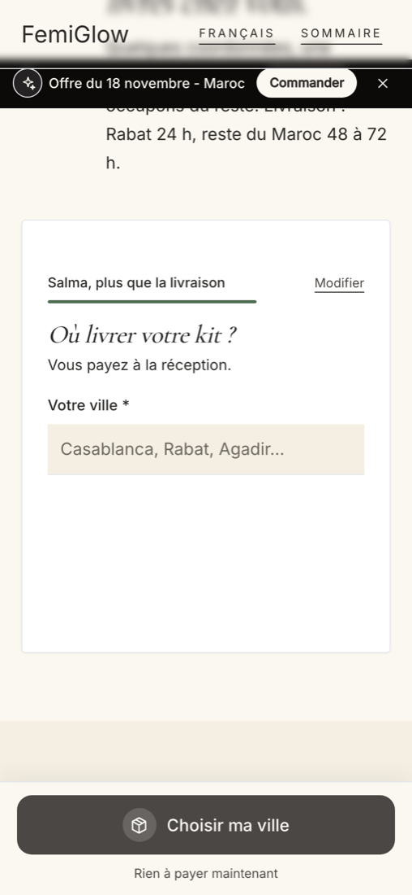

# 01 — Audit de la situation actuelle

Code lu sur `fix/kit-bugs-graves` (`532ceebd`). La production sert `2a530076`, compilation `f6jtv7ge9qw3xXa2lLxsF` (vérifié le 18/11/2026 à 11:22 UTC). Écrans capturés sur une copie locale, vue mobile 390 × 844.

## 1. Ce qui se passe vraiment

| Moment | Côté cliente | Côté serveur |
|---|---|---|
| Étape 1 validée | Passe à l'étape 2 immédiatement | La fiche (`chat_lead`) est créée en tâche de fond, avec prénom, téléphone, panier et code promo |
| Étape 2, ville choisie | Voit les frais et le délai | La ville est enregistrée sur la fiche (`address/draft`) |
| Étape 2, adresse saisie | Voit le bouton « Confirmer ma commande » | L'adresse est enregistrée à la sortie du champ |
| Bouton grenat | Écran de remerciement | Commande créée, stock retiré, achat envoyé aux régies |
| Départ sans confirmer | Rien | Après le délai réglé dans l'admin (5 minutes en production le 18/11, réglable de 1 à 60), la fiche part au CRM. L'équipe appelle |

Fichiers : `LeadCaptureStep.tsx`, `AddressStepV2.tsx`, `use-address-form.ts`, `use-wizard-mutations.ts`, `lead-step1-abandon-scanner.ts`, `app/api/cron/tick/route.ts`.

Conséquence : dès l'étape 1, la cliente **sera** appelée, qu'elle termine ou non. L'écran ne le dit pas.

## 2. L'écran actuel

| Élément | Texte | Remarque |
|---|---|---|
| Ligne de progression | « Salma, plus que la livraison » | Laisse entendre que rien n'est encore pris en compte |
| Titre | « Où livrer votre kit ? » | Clair |
| Sous-titre | « Vous payez à la réception. » | Rassure sur le paiement, pas sur la suite |
| Champ | « Votre ville » | Seul champ à l'arrivée |
| Barre fixe | « Choisir ma ville », « Rien à payer maintenant » | Guide vers le champ |
| Reste de la carte | Environ 300 px vides | Place disponible sans défilement |

## 3. Où l'appel est annoncé aujourd'hui

| Endroit | Texte | Poids |
|---|---|---|
| Étape 1, sous le titre | « Deux informations seulement — nous vous rappelons pour confirmer. » | Phrase grise, lue avant de remplir |
| Étape 1, case cochée d'avance | « Je veux être rappelée pour confirmer ma commande. » | Cochée par défaut, rarement lue |
| Étape 2 | Rien | — |
| Remerciement | « Commande reçue, on vous rappelle. » | Vu seulement par celles qui terminent |

Celle qui quitte à l'étape 2 n'a donc lu l'annonce qu'une fois, avant de donner son numéro, et jamais après.

## 4. Constats

| # | Constat | Effet |
|---|---|---|
| 1 | Aucun accusé après l'étape 1 | La cliente qui part pense n'avoir rien commandé. L'appel la surprend : elle décroche moins et refuse plus |
| 2 | Aucune raison donnée de remplir la ville | « Plus que la livraison » ne dit pas ce qu'elle y gagne |
| 3 | Numéro jamais relu | Une faute de frappe donne une cliente injoignable, sans qu'elle puisse le voir |
| 4 | Deux issues de valeur très différente | Commande finie sur le site : 74 % de colis livrés. Rappel après abandon : 42 % (Trello, 05/11). Tout ce qui fait finir sur le site rapporte plus |
| 5 | L'enregistrement peut échouer en silence | La fiche part en tâche de fond. En cas d'échec, seul un bandeau discret le signale (`WizardSyncIndicator`). Tout message « c'est noté » doit en tenir compte |
| 6 | La bannière « Bon retour, Salma » apparaît pendant la première saisie de l'étape 1 | Hors sujet ici, à corriger à part : la condition compare le prénom tapé au brouillon, qui est le même |

## 5. Contraintes à respecter

- **Ne pas créer de commande à la place de la cliente.** Stock, total, frais et suivi des achats dépendent de la commande.
- **Ne pas dire « commande confirmée ».** Ce serait faux tant que le bouton grenat n'est pas pressé, et cela inviterait à partir.
- **Garder le champ ville visible avec le clavier ouvert.** L'étape 2 a été refaite le 31/10 pour tenir sans défiler.
- **Français, arabe (de droite à gauche), anglais.** Le numéro se lit toujours de gauche à droite.
- **Aucune donnée personnelle dans la mesure.** Ni prénom, ni numéro dans les événements.

## 6. Ce qui n'a pas pu être mesuré

L'accès en lecture à la base de production a été refusé à l'agent. L'entonnoir du jour se lit avec `bash bin/deployer-accuse.sh mesurer` (lecture seule) : fiches, commandes, fiches sans commande, fiches envoyées au CRM, par jour.
